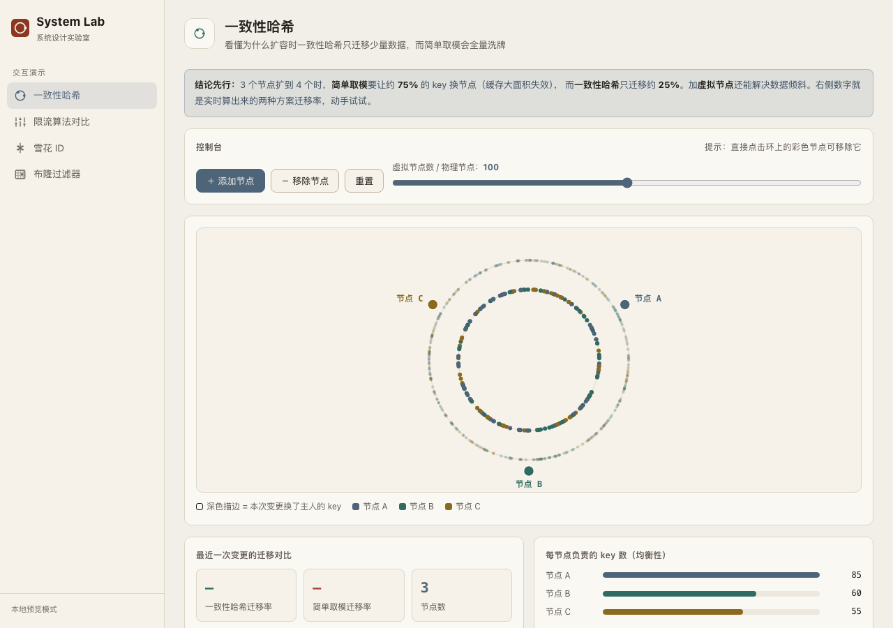

# Starry Lab · 高频面试题图解 + 交互实验室

> 把后端高频面试题**一步步画给你看**：30 秒答案 → 分步图解 → 追问链 → 动手实验。
> 初级也能一路看懂，看完图还能跳进实验室亲手把结论「拨」出来。
>
> 这是一份个人作品：选题、模拟内核、交互与文案由一人独立完成，源码与测试全部公开。

**在线地址**：[https://starryknight1231.github.io/](https://starryknight1231.github.io/)



## 两层结构

**第一层：题库图解（首页主区）**——8 道后端高频题（首批，难度从低到高），每道题：
30 秒答案（初级直接背）→ 6 步左右分步 SVG 图解（每步只讲一件事，术语就地解释）→
追问链（面试官典型追问 + 应对）→ 动手实验深链 → 面试要点（口诀与边界）。
内容与图解全部来自 [`qa-deck.js`](qa-deck.js)——纯数据 + SVG 生成函数，由测试保证结构完整。

| # | 题目 | 分类 |
|---|------|------|
| 1 | TCP 三次握手，为什么两次不行？ | 网络 |
| 2 | 从输入网址到页面显示，发生了什么？ | 网络 |
| 3 | MySQL 四个隔离级别，各解决什么问题？ | 数据库 |
| 4 | 缓存穿透、击穿、雪崩的区别与防法 | 数据库 |
| 5 | 为什么需要一致性哈希？ | 分布式 |
| 6 | 雪花 ID 为什么这样设计位段？ | 分布式 |
| 7 | volatile 到底保证什么、不保证什么？ | Java 并发 |
| 8 | 线程池 7 个参数怎么配？任务怎么走？ | Java 并发 |

**第二层：交互实验室**——8 个可动手的应用，题解里的每个结论都能在这里亲手验证。

## 为什么做这个

一致性哈希、Raft、MVCC、TCP 拥塞控制……这些主题的文章很多，但绝大多数是「读了一遍以为懂了」。
这里换一种方式：**每道题先把图一步步画到位，再把结论交给你动手验证**。
参数拖一下、节点删一个、分区切一刀，数字是页面当场算出来的，不是预先写死的。

## 在线实验室

| 应用 | 内容 |
|------|------|
| **[DevBox](https://starryknight1231.github.io/apps/devbox/)** 开发者工具箱 | 16 个高频工具：JSON 格式化（错误定位行列）、Base64 / URL / HTML 实体、JWT 解码、正则测试（高亮+捕获组+替换）、SHA 哈希、时间戳、进制、颜色（含色阶）、UUID、密码熵值、Markdown 预览、HTTP 状态码速查… |
| **[System Lab](https://starryknight1231.github.io/apps/system-lab/)** 系统设计实验室 | 4 个交互演示：一致性哈希（CH vs 取模迁移率实测、虚拟节点）、四种限流算法同屏对比（固定窗口/滑动窗口/令牌桶/漏桶）、雪花 ID（位级拆解+时钟回拨模拟）、布隆过滤器（理论 vs 实测误判率） |
| **[RegexVis](https://starryknight1231.github.io/apps/regexvis/)** 正则可视化 | 正则 → 逐段中文解释 + Thompson NFA 状态机图 + 逐字符匹配动画（ε-闭包可视化、贪婪/懒惰分支走向、前瞻断言） |
| **[JMM Lab](https://starryknight1231.github.io/apps/jmm-lab/)** Java 并发实验室 | 8 条 happens-before 规则图解、volatile 可见性动画（主存/工作内存同步过程）、20 万次交错重排实验、线程六状态机（点击看代码与误区）、DCL 单例步进推演 |
| **[LogLens](https://starryknight1231.github.io/apps/loglens/)** 日志时间线分析器 | 粘贴多行分布式日志：自动识别 3 种时间戳格式、按线程/服务分泳道渲染瀑布图、标记可疑 gap、按时长画横条、ERROR 按模板聚类 |
| **[Raft Lab](https://starryknight1231.github.io/apps/raft-lab/)** 共识协议实验室 | 4 个事件驱动的 Raft 演示：领导选举（随机 vs 固定超时的活锁对照）、日志复制与提交（多数派计数、commitIndex 推进）、可以逐条关掉的安全规则（up-to-date 限制、只提交当前 term）、分区后哪一侧还能写 |
| **[MVCC Lab](https://starryknight1231.github.io/apps/mvcc-lab/)** 事务隔离实验室 | 5 个隔离级别（RU/RC/RR/SI/SER）下的真实语义：PG 快照可见性逐步判定、脏读/不可重复读/幻读/丢失更新由引擎按执行历史判出、写偏斜的三种堵法、优先图环检测与严格 2PL |
| **[Wire Lab](https://starryknight1231.github.io/apps/wire-lab/)** 网络传输实验室 | 4 个时序仿真：TCP 握手/挥手的 seq 与 ACK 实时推导（TIME_WAIT、同时关闭）、逐 RTT 的 cwnd 曲线（Reno/NewReno/CUBIC、快恢复与快重传）、五种投递模型的页面加载对比、TLS 1.2/1.3/QUIC 的握手轮次与首字节时间 |

**规划中**：curl2code（curl ↔ Java/Go/Python 代码互转）。做完才上线，不放占位假链接。

## 实现要点

整个仓库没有一行第三方代码。几点值得说的工程决定：

- **内核与 UI 分层，内核可脱离浏览器验证**
  [`raft-core.js`](apps/raft-lab/js/raft-core.js)（事件驱动的集群模拟内核）、[`mvcc-core.js`](apps/mvcc-lab/js/mvcc-core.js)（事务执行引擎）、[`parser.js + nfa.js`](apps/regexvis/js/nfa.js)（正则解析与 Thompson NFA）
  都不碰 DOM，挂在全局对象上；页面只是把内核的输出画出来。因此 `node tests/run.mjs` 能在 Node 里直接测它们。

- **虚拟时钟 + 可种子化随机 = 场景可复现**
  Raft 不用 `setTimeout`：所有事件进一个按虚拟时间排序的优先队列，随机数来自带种子的 `mulberry32`。
  同一个 seed 下，选举、分区、活锁的每一步都可以精确重放，测试也因此是确定性的。

- **异常是判定出来的，不是写死的**
  MVCC Lab 的脏读/不可重复读/幻读/丢失更新/写偏斜，全部由执行历史现场计算：事务按隔离级别产生快照与锁行为，
  引擎对结果历史做异常判定与冲突优先图环检测。换一个操作序列，结论跟着变——页面里没有一句硬编码的「正确答案」。

- **PG 风格的快照可见性**
  [`mvcc-core.js`](apps/mvcc-lab/js/mvcc-core.js) 的 `traceVisible` 按 PostgreSQL `tqual.c` 的判定顺序逐步推演
  （xmin/xmax 与 Read View 的 xmin/xmax/xip 比较，含回滚 hint 位），每一步给出判据文本，UI 逐行展示判定过程。

- **严格的全串匹配语义**
  RegexVis 的匹配仿真以「整个输入被消耗且停在接受态」为 accepted，锚点与前瞻断言是零宽 ε 边，
  语义与把正则包上 `^...$` 等价——比「找到子串就算匹配」更严格，动画也因此能精确解释失败发生在哪个字符。

## 测试

零依赖，Node 18+ 直接跑，不需要安装任何东西：

```bash
node tests/run.mjs
```

四个套件、168 个断言：Raft（选举收敛/复制/分区愈合/Figure 8 时间线/安全规则开关对照）、
MVCC（快照可见性判定、优先图环检测、五类异常由引擎判出）、RegexVis（NFA 全串匹配、锚点、前瞻、非法正则报错）、
QA Deck（题库数据完整性：8 题、字段齐全、步数与图层数对齐、实验室深链真实存在）。

```text
══ Raft 内核 · 选举 / 复制 / 安全规则 ══
  — 网络分区与愈合
  PASS  少数派一侧 leader 的 commitIndex 无法推进
  PASS  新条目只追加到本地日志、始终未被提交
  PASS  多数派一侧已选出更高 term 的新主
  ...
══ MVCC 内核 · 可见性判定与异常判出 ══
  — 写偏斜（SI vs SER）
  PASS  SI 下写偏斜发生：两人同时请假，值班约束被打破
  PASS  SER 守住约束：至少一位值班医生在岗
  ...
  168 passed · 0 failed · 0.1s
```

安全规则的开关对照是这套测试的核心场景：关掉 up-to-date 投票限制，缺已提交条目的候选者会当选，
引擎当场判出「领导完整性 + 状态机安全」双重违例；关掉「只提交当前 term」，旧 term 条目被错误提交，同样判出违例。
规则全开时同一批场景全部无违例。

## 设计原则

- **零依赖**：不引入任何第三方库/框架，哈希是手写的 FNV-1a，动画是原生 Canvas 和 requestAnimationFrame。
- **演示即结论**：参数拖一下、节点删一个，数字是自己算出来的——这不是八股背诵页。
- **诚实生长**：应用矩阵随时间自然增加，做完才放上来，不刷格子。

## 已知边界

诚实声明，避免误解：

- 这是**浏览器内的教学模拟**，不是生产实现：Raft 内核省略了快照与成员变更，MVCC 引擎模拟单表语义，
  正则引擎有 400 状态 / 16 展开份数的上限。边界在代码里有注释。
- 所有计算都在本地浏览器完成，无后端、无账号、无埋点。
- 窄屏可用（画布支持横向滑动），但交互体验以桌面优先。

## 本地运行

无构建步骤，任选其一：

```bash
# 直接双击 index.html
# 或
python3 -m http.server 8080
# 访问 http://localhost:8080
```

## 目录结构

```
├── index.html              # 门户：题库图解（主区）+ 动手实验室（底部）
├── qa-deck.js              # 题解内容层：8 题的分步图解数据（纯数据 + SVG）
├── apps/
│   ├── devbox/             # 开发者工具箱
│   ├── system-lab/         # 系统设计实验室（每个演示一个文件，互不影响）
│   ├── regexvis/           # 正则可视化
│   ├── jmm-lab/            # Java 并发实验室
│   ├── loglens/            # 日志时间线分析器
│   ├── raft-lab/           # 共识协议实验室
│   ├── mvcc-lab/           # 事务隔离实验室
│   └── wire-lab/           # 网络传输实验室
└── tests/                  # 内核与题库测试（零依赖，node tests/run.mjs）
```

## License

[MIT](LICENSE)
